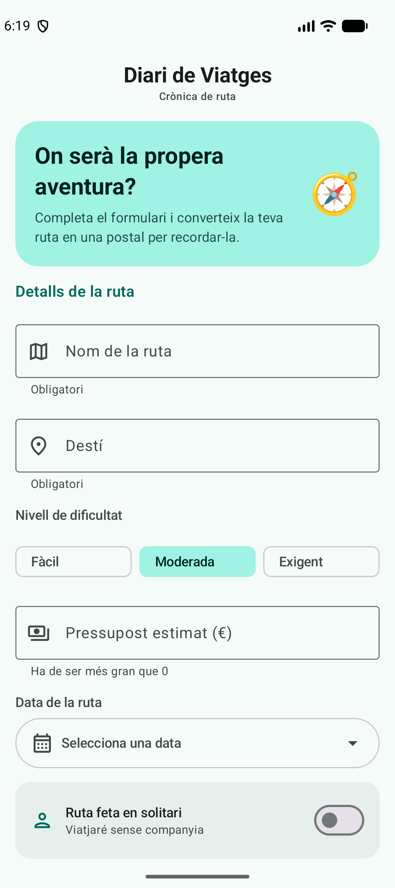
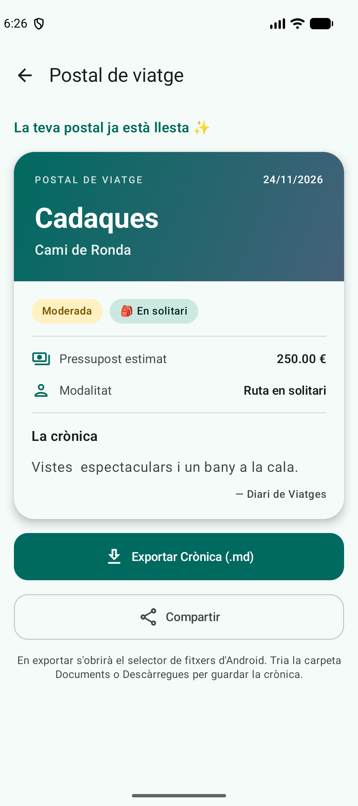
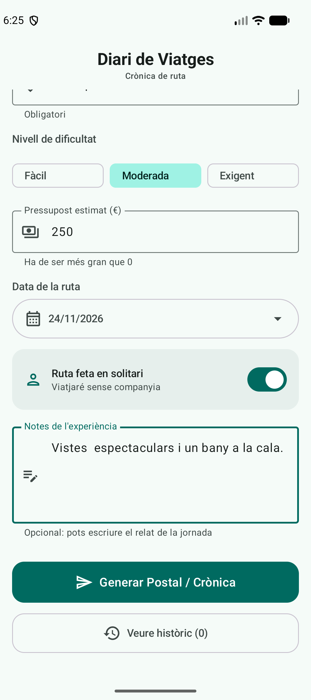
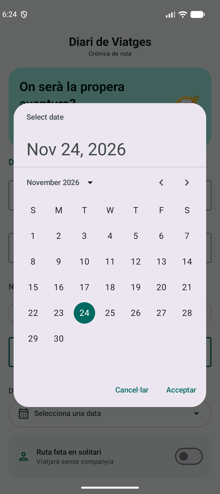
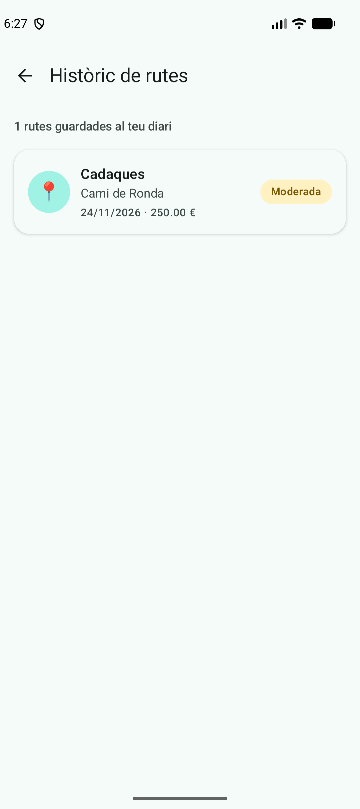
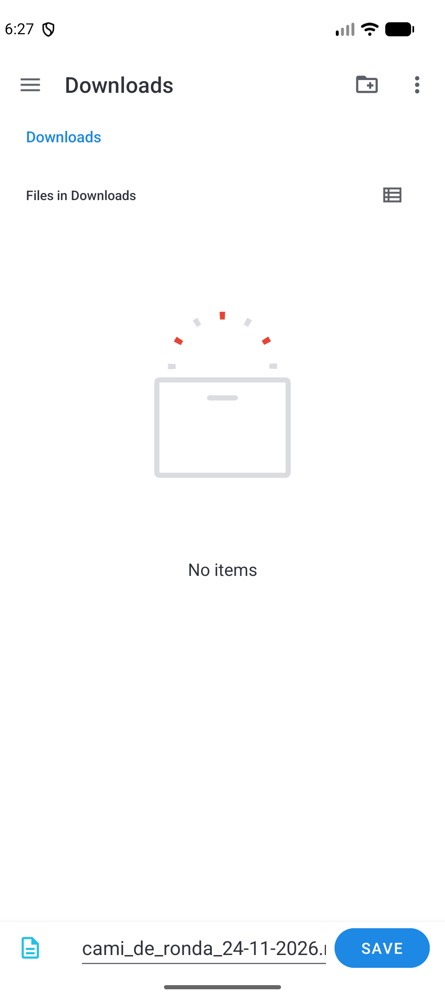

# Rutes de Viatge · Diari de Viatges / Crònica de Ruta

Aplicació Android desenvolupada amb **Kotlin**, **Jetpack Compose** i arquitectura **MVVM** per registrar rutes i escapades, generar una postal visual de cada viatge i guardar l'històric de forma persistent.

Projecte de **DAM2 · Programació de Mòbils**.

---

## Funcionalitats

- Formulari de nova ruta amb:
  - Nom de la ruta i destí obligatoris.
  - Dificultat seleccionable amb **FilterChips** (Fàcil, Moderada, Exigent).
  - Pressupost estimat amb teclat decimal.
  - Data seleccionada amb **DatePickerDialog** de Material 3.
  - Interruptor **Switch** per indicar si la ruta es fa en solitari.
  - Notes multilínia per escriure la crònica.
- Validació visual en temps real i botó **Generar Postal / Crònica** desactivat mentre el formulari no sigui vàlid.
- Navegació amb **Navigation Compose** i pas de dades entre pantalles.
- Postal amb data, destí destacat, insígnia de dificultat, pressupost, modalitat i relat.
- **Emmagatzematge intern** automàtic de cada ruta a `filesDir/diari_viatges.json`.
- **Històric** de totes les rutes guardades, amb accés des del formulari.
- **Exportació** de la crònica amb **Storage Access Framework** (`CreateDocument`).
- **Compartir** la crònica amb `Intent.ACTION_SEND`.

---

## Captures de pantalla

| Formulari de nova ruta | Postal de viatge |
| --- | --- |
|  |  |

| Formulari complet | Selector de data |
| --- | --- |
|  |  |

| Històric de rutes | Exportació amb SAF |
| --- | --- |
|  |  |

---

## Arquitectura MVVM

```
┌─────────────────────────────┐
│  Vista (Jetpack Compose)    │
│  FormScreen / PostalScreen  │
│  HistoryScreen              │
└──────────────┬──────────────┘
               │ esdeveniments (onClick, onValueChange...)
               ▼
┌─────────────────────────────┐
│  TravelDiaryViewModel       │
│  MutableStateFlow privat    │
│  StateFlow públic           │
│  Validació + accions        │
└──────────────┬──────────────┘
               │ loadRoutes() / saveRoutes()
               ▼
┌─────────────────────────────┐
│  TravelDiaryRepository      │
│  filesDir/diari_viatges.json│
└─────────────────────────────┘
```

### Model

- `RouteEntry`: `data class` immutable amb `id`, `routeName`, `destination`, `difficulty`, `estimatedBudget`, `date`, `isSolo` i `notes`. També conté la conversió a JSON (`toJson` / `fromJson`) i a Markdown (`toMarkdown`).
- `TravelDiaryUiState`: estat complet de la interfície. Inclou els camps del formulari, els errors de validació, l'històric i l'indicador de càrrega. La propietat `isFormValid` calcula si es pot activar el botó de generar.
- `Difficulty`: enum amb els textos que es mostren a la interfície.

### ViewModel

`TravelDiaryViewModel` hereta d'`AndroidViewModel` per poder accedir a `application.filesDir`.

- L'estat es guarda en un `MutableStateFlow` privat i s'exposa com a `StateFlow` de només lectura amb `.asStateFlow()`.
- Tots els canvis es fan de forma immutable amb `.update { it.copy(...) }`.
- La validació s'executa mentre l'usuari escriu i també abans de generar la ruta.
- La lectura i l'escriptura del fitxer es fan amb `viewModelScope` i `Dispatchers.IO` per no bloquejar la interfície.

### Vista

- `FormScreen`: formulari i validació visual.
- `PostalScreen`: targeta visual de la ruta, exportació i compartir.
- `HistoryScreen`: llista de rutes desades.
- `AppNavHost`: grafo de navegació. La postal rep l'`id` de la ruta com a argument de navegació i el ViewModel la busca a l'històric. Així no cal passar objectes grans entre pantalles.

### Per què el ViewModel és únic per a tota l'app?

A `MainActivity` es crea una sola instància amb `viewModel()` i es passa al `NavHost`. D'aquesta manera:

- L'estat sobreviu a canvis de configuració (per exemple, girar el mòbil).
- El formulari, la postal i l'històric comparteixen les mateixes dades.
- No es dupliquen càrregues del fitxer JSON.

---

## Estructura del projecte

```
app/src/main/java/org/proven/rutesdeviatge/
├── MainActivity.kt
├── data/
│   └── TravelDiaryRepository.kt
├── model/
│   ├── RouteEntry.kt
│   └── TravelDiaryUiState.kt
├── navigation/
│   └── AppNavHost.kt
├── ui/
│   ├── components/
│   │   └── DifficultyBadge.kt
│   ├── screens/
│   │   ├── FormScreen.kt
│   │   ├── HistoryScreen.kt
│   │   └── PostalScreen.kt
│   └── theme/
│       ├── Color.kt
│       ├── Theme.kt
│       └── Type.kt
└── viewmodel/
    └── TravelDiaryViewModel.kt
```

---

## Emmagatzematge intern vs. extern (SAF)

| | Emmagatzematge intern (`filesDir`) | Emmagatzematge extern (SAF) |
| --- | --- | --- |
| Ubicació | `/data/data/org.proven.rutesdeviatge/files/diari_viatges.json` | Carpeta triada per l'usuari (Documents, Descàrregues...) |
| Accés | Només l'aplicació | L'usuari i les apps que ell autoritzi |
| Permisos | Cap permís especial | Cap permís de storage: es fa servir el selector del sistema |
| Persistència | Es manté mentre l'app estigui instal·lada | El fitxer és de l'usuari i es manté fora de l'app |
| En desinstal·lar l'app | **S'esborra** juntament amb les dades privades | **Es conserva**, perquè no pertany a l'app |
| Ús en aquest projecte | Històric automàtic de totes les rutes | Exportació manual de la crònica en `.txt` |

### Diferència pràctica

L'emmagatzematge intern és ideal per a les dades pròpies de l'aplicació: és privat, ràpid i no necessita permisos. El problema és que l'usuari no hi pot accedir directament i, si desinstal·la l'app, les dades desapareixen.

L'emmagatzematge extern amb SAF serveix perquè l'usuari decideixi on guardar una còpia. En aquest projecte, el botó **Exportar Crònica (.txt)** obre el selector de fitxers del sistema amb `ActivityResultContracts.CreateDocument("text/plain")`. Quan l'usuari tria una carpeta, rebem una `Uri` i hi escrivim el text en format Markdown amb `contentResolver.openOutputStream(uri)`. Aquest fitxer sobreviu a la desinstal·lació perquè ja no depèn de l'aplicació.

---

## Flux d'ús

1. L'usuari omple el formulari. Els errors apareixen si un camp obligatori queda buit o si el pressupost no és un número positiu.
2. En prémer **Generar Postal / Crònica**:
   - Es valida el formulari.
   - Es crea un `RouteEntry` amb un `UUID`.
   - S'afegeix a l'històric i es desa al fitxer JSON intern.
   - Es navega a `postal/{routeId}`.
3. A la postal es pot:
   - **Exportar** la crònica en un fitxer `.txt` amb contingut Markdown.
   - **Compartir** el text amb una altra app.
4. Des del formulari es pot obrir l'**històric** i recuperar qualsevol postal anterior.
5. En tornar a obrir l'app, el ViewModel llegeix `diari_viatges.json` i recupera l'històric.

---

## Conceptes apresos i comentats al codi

- **`OutlinedTextField`**: camps de text amb etiqueta, icona, estat d'error i text d'ajuda.
- **`FilterChip`**: selector d'una sola opció per a la dificultat.
- **`DatePickerDialog` + `rememberDatePickerState`**: selecció de data amb Material 3. La data es converteix a `dd/MM/yyyy` amb `SimpleDateFormat` en UTC per evitar desplaçaments de dia.
- **`Switch`**: opció booleana per al viatge en solitari.
- **`MutableStateFlow` / `StateFlow` / `.asStateFlow()`**: estat reactiu del ViewModel.
- **`.update { it.copy(...) }`**: actualització immutable de l'estat.
- **`collectAsStateWithLifecycle()`**: recollida de l'estat respectant el cicle de vida de Compose.
- **Navigation Compose**: `NavHost`, `composable`, `navArgument` i pas de l'`id` de la ruta.
- **`JSONObject` / `JSONArray`**: serialització i lectura de l'històric sense llibreries externes.
- **`filesDir`**: emmagatzematge privat persistent.
- **`ActivityResultContracts.CreateDocument`**: selector de fitxers del sistema (SAF).
- **`ContentResolver.openOutputStream`**: escriptura del fitxer exportat a la `Uri` triada.
- **`Intent.ACTION_SEND`**: compartir text amb WhatsApp, correu, etc.
- **`viewModelScope` + `Dispatchers.IO`**: operacions de disc fora del fil principal.
- **Material 3 i tema propi**: paleta inspirada en el mar i la sorra, amb suport de mode fosc.

---

## Com executar el projecte

Requisits:

- Android Studio amb JDK 17 o superior.
- SDK d'Android amb la plataforma indicada pel projecte (`compileSdk 37`).
- Un dispositiu o emulador amb Android 7.0 (API 24) o superior.

Passos:

1. Obre la carpeta `RutesDeViatge` amb Android Studio.
2. Espera que Gradle sincronitzi les dependències.
3. Executa l'app amb el botó **Run**.

També es pot compilar per terminal:

```bash
./gradlew :app:assembleDebug
```

L'APK es genera a:

```
app/build/outputs/apk/debug/app-debug.apk
```

---

## Proves realitzades

- Compilació correcta amb `./gradlew :app:assembleDebug`.
- Formulari provat amb camps buits, pressupost incorrecte i dades vàlides.
- Generació de la postal i navegació entre pantalles.
- Tancament i reobertura de l'app per comprovar que l'històric es recupera del JSON.
- Exportació d'una crònica des del selector de fitxers del sistema.
- Compartició del text amb el selector d'apps d'Android.

---

## Repositori de GitHub

Nom proposat: **Android-DiariViatges-Storage**.

Per pujar el projecte:

```bash
git init
git add .
git commit -m "Projecte Rutes de Viatge amb MVVM, storage intern i exportació SAF"
git branch -M main
git remote add origin https://github.com/USUARI/Android-DiariViatges-Storage.git
git push -u origin main
```

> Recorda crear abans el repositori **públic** a GitHub i substituir `USUARI` pel teu nom d'usuari.

---

## Possibles millores

- Editar i eliminar rutes de l'històric.
- Guardar una foto del lloc visitat.
- Migrar l'emmagatzematge a Room.
- Afegir tests unitaris del ViewModel i de la validació.
- Traduir la interfície a diversos idiomes amb `strings.xml`.
